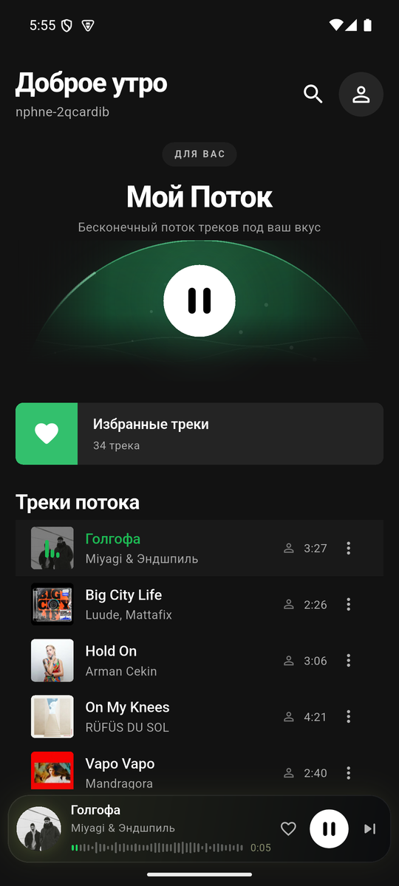
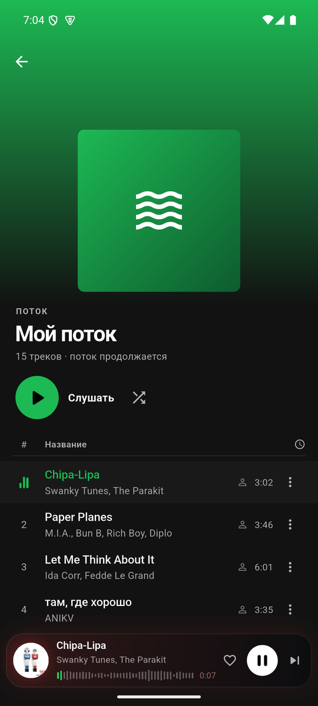
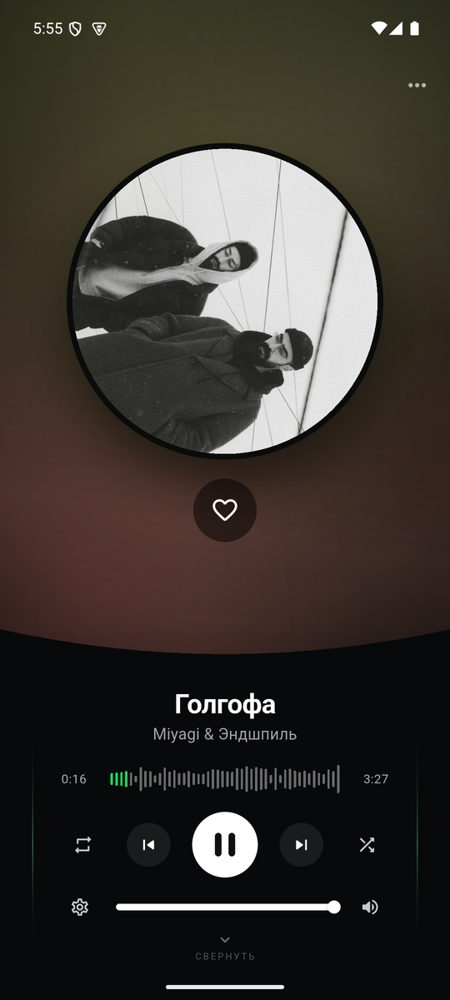

  

<h1 align="center">Listen Music</h1>

  <b>Бесплатный музыкальный плеер для Android и Windows — для всех, кто любит музыку.</b> 
  Без рекламы. Без подписок. Без скрытых платежей.

  <a href="../../releases/latest/download/ListenMusic.apk"><b>⬇ Скачать для Android</b></a>
  &nbsp;·&nbsp;
  <a href="../../releases/latest/download/ListenMusic-windows.zip"><b>⬇ Скачать для Windows</b></a>

  
  
  
  

## Скриншоты

  
  
  

## Возможности

- **«Мой поток»** — бесконечная персональная подборка, которая подстраивается
  под ваш вкус.
- **Главная как в больших сервисах**: новые релизы, топ треков из чарта и
  популярные плейлисты.
- **Поиск** по трекам, исполнителям и альбомам.
- **Плейлисты и лайки**: создавайте свои, добавляйте и меняйте порядок треков.
- **Большой плеер**: живой фон в цветах обложки, эквалайзер, тексты песен,
  очередь и сон-таймер.
- **Статистика прослушивания**: любимые жанры на кольцевой диаграмме,
  топ исполнителей и время за неделю, месяц или всё время.
- **Тёмная тема** и аккуратный интерфейс на русском.
- **Android и Windows** — один аккаунт, одна библиотека и одинаковые возможности.

## Установка

### Android

1. Скачайте **ListenMusic.apk** по кнопке выше.
2. Откройте файл и разрешите установку из этого источника, если Android
   спросит.
3. Войдите в свой аккаунт — и слушайте.

Требуется Android 7.0 или новее. Обновления устанавливаются поверх старой
версии, настройки сохраняются.

### Windows

1. Скачайте **ListenMusic-windows.zip**.
2. Распакуйте в любую папку.
3. Запустите `yandex_music_player.exe`.

Требуется Windows 10/11 x64. Установка не нужна — приложение портативное.

## Частые вопросы

**Это действительно бесплатно?**
Да. Приложение бесплатное, без рекламы и встроенных покупок. Для входа нужен
аккаунт Яндекс Музыки; отдельные треки могут быть доступны только с подпиской
сервиса.

**Где брать обновления?**
В разделе [Releases](../../releases). Новая версия ставится поверх старой.

**Куда уходят мои данные?**
Никуда: настройки, история и статистика хранятся только на устройстве.
Приложение не собирает аналитику и не показывает рекламу.

**Где исходный код?**
Исходники не публикуются. Здесь выкладываются только готовые файлы для
установки и скриншоты.

**Приложение официальное?**
Нет. Listen Music — неофициальный клиент, не связанный с Яндексом. Права на
музыку принадлежат правообладателям; приложение не хранит и не распространяет
аудиофайлы.

---

Сделано для меломанов · <a href="../../releases/latest">Все версии</a>

