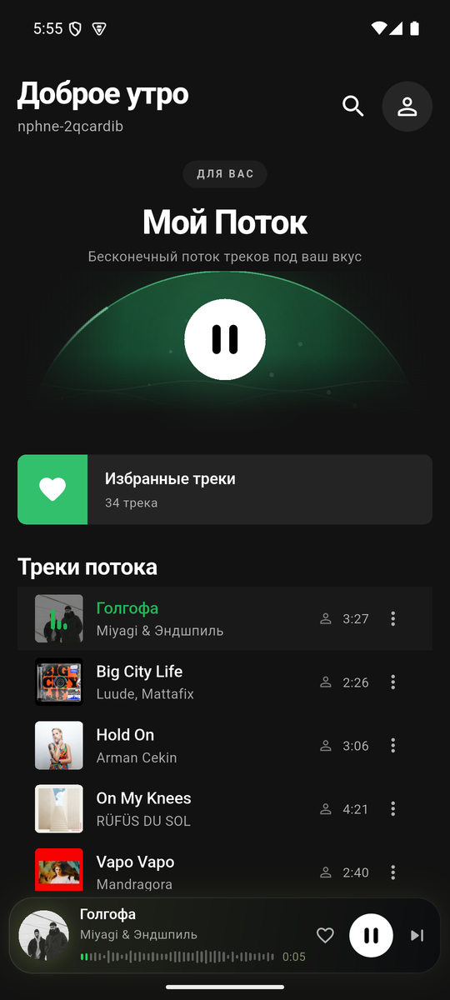
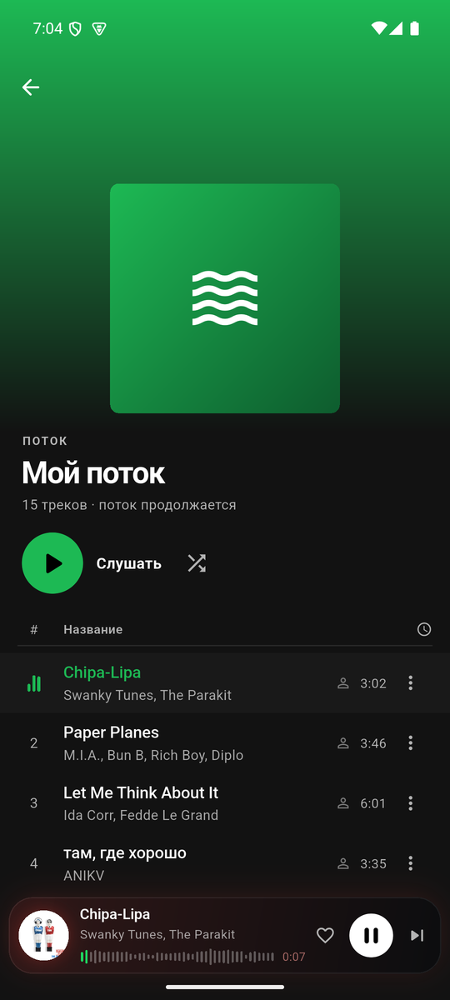
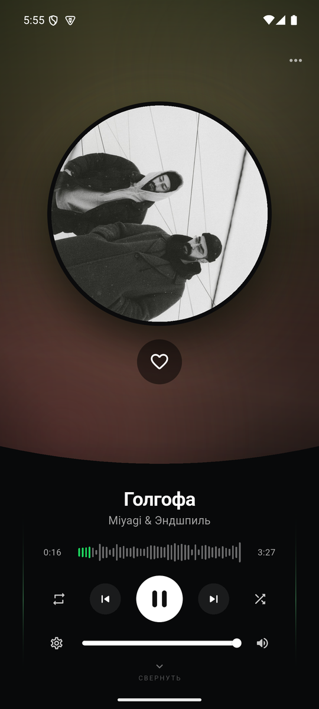

  

<h1 align="center">Listen Music — Яндекс Музыка для Android и Windows</h1>

  <b>Неофициальный клиент Яндекс Музыки и бесплатная альтернатива официальному приложению.</b> 
  Скачайте APK или портативную версию для Windows, войдите в аккаунт и слушайте музыку — 
  без рекламы, без встроенных покупок и без подписки на приложение.

  <a href="../../releases/latest/download/ListenMusic.apk"><b>⬇ Скачать бесплатно для Android</b></a>
  &nbsp;·&nbsp;
  <a href="../../releases/latest/download/ListenMusic-windows.zip"><b>⬇ Скачать для Windows</b></a>
  &nbsp;·&nbsp;
  <a href="https://discord.gg/DjvwgwSrnC"><b>💬 Discord</b></a>

  
  
  
  
  

> **Listen Music** — неофициальный клиент Яндекс Музыки для Android и Windows.
> Это бесплатная альтернатива официальному приложению: без рекламы, платных
> функций и собственной подписки. Для входа нужен аккаунт Яндекс Музыки.

## Яндекс Музыка на ПК и телефоне

Listen Music — это отдельный клиент Яндекс Музыки для Windows 10/11 и Android.
Он пригодится, если вы ищете:

- **как слушать Яндекс Музыку на компьютере** без браузера и вкладок;
- **клиент Яндекс Музыки для Windows** или Android с тёмным интерфейсом;
- **бесплатную альтернативу официальному приложению** Яндекс Музыки;
- **неофициальный клиент Яндекс Музыки** с персональным потоком, плеером и
  статистикой, а не урезанную веб-версию;
- **мод на Яндекс Музыку** — но важно: Listen Music не является модом или
  взломанной версией (подробнее в вопросах ниже).

Приложение не заменяет аккаунт Яндекс Музыки и не обходит оплату сервиса: оно
показывает те треки, которые доступны вашему аккаунту.

## Скачать Listen Music бесплатно

| Платформа | Файл | Требования |
|---|---|---|
| **Android** | [`ListenMusic.apk`](../../releases/latest/download/ListenMusic.apk) | Android 7.0 и новее |
| **Windows** | [`ListenMusic-windows.zip`](../../releases/latest/download/ListenMusic-windows.zip) | Windows 10/11 x64 |

Все версии и контрольные суммы — в разделе [Releases](../../releases).
Новая версия устанавливается поверх старой, настройки и вход сохраняются.
Новости и поддержка — в [Discord-сообществе](https://discord.gg/DjvwgwSrnC).

## Скриншоты

  
  
  

## Почему выбирают Listen Music

- **Бесплатно и без рекламы.** Ни баннеров, ни аудиорекламы, ни встроенных
  покупок.
- **Без подписки на приложение.** Все функции доступны сразу после входа в
  аккаунт.
- **Лёгкий и быстрый.** Не нужно мощное устройство: плеер работает на Android
  и Windows.
- **Музыка в один клик.** Персональный поток, плейлисты, лайки и поиск — всё на
  главном экране.
- **Аккуратный тёмный интерфейс** на русском языке.
- **Портативная Windows-версия.** Скачал, распаковал, запустил — установка не
  нужна.

## Чем Listen Music отличается от официального приложения

| | Listen Music | Официальное приложение |
|---|---|---|
| Цена | Бесплатно | Бесплатно |
| Реклама | Нет | Зависит от тарифа |
| Подписка на приложение | Нет | Нет |
| Персональный поток | Да | Да |
| Плейлисты и лайки | Да | Да |
| Статистика жанров | Да | Ограниченно |
| Android и Windows | Да | Android, iOS, Windows |
| Открытый APK без магазина | Да | Нет |

## Возможности

- **«Мой поток»** — бесконечная персональная подборка, которая подстраивается
  под ваш вкус.
- **Главная как в больших сервисах**: новые релизы, топ треков из чарта и
  популярные плейлисты.
- **Поиск** по трекам, исполнителям и альбомам.
- **Плейлисты и лайки**: создавайте свои, добавляйте и меняйте порядок треков.
- **Большой плеер**: живой фон в цветах обложки, настройка обложки, фона и
  акцента, эквалайзер, тексты песен, очередь и сон-таймер.
- **Статус Discord на Windows**: в профиле видно, какой трек играет, с
  обложкой и прогрессом.
- **Статистика прослушивания**: любимые жанры на кольцевой диаграмме, топ
  исполнителей и время за неделю, месяц или всё время.
- **Тёмная тема** и интерфейс на русском.
- **Android и Windows** — один аккаунт, одна библиотека и одинаковые
  возможности.

## Установка

### Как установить на Android

1. Скачайте **ListenMusic.apk** по кнопке выше.
2. Откройте файл. Если Android попросит — разрешите установку из этого
   источника.
3. Войдите в аккаунт и слушайте музыку.

Требуется Android 7.0 или новее. APK подписан ключом проекта, поэтому
обновления ставятся поверх без удаления приложения.

### Как установить на Windows

1. Скачайте **ListenMusic-windows.zip**.
2. Распакуйте архив в любую папку.
3. Запустите **Listen Music.exe**.

Требуется Windows 10/11 x64. Установка не нужна — приложение портативное.

## Частые вопросы

**Это действительно бесплатно?**
Да. Listen Music бесплатный: без рекламы, встроенных покупок и подписки на
приложение. Для входа нужен аккаунт Яндекс Музыки.

**Как слушать Яндекс Музыку без подписки?**
Скачайте Listen Music и войдите в свой аккаунт Яндекс Музыки. Само приложение
бесплатное и не требует подписки на него. Доступ к каталогу зависит от вашего
аккаунта и условий сервиса: Listen Music не обходит оплату и ограничения
Яндекс Музыки.

**Это мод на Яндекс Музыку?**
Нет, это самостоятельный клиент, а не модификация официального приложения. Он
ставится отдельно, не заменяет официальное приложение, не требует root и не
меняет его файлы.

**Где скачать клиент Яндекс Музыки для Windows или Android?**
Файлы лежат в разделе [Releases](../../releases): `ListenMusic.apk` для Android
7.0+ и `ListenMusic-windows.zip` для Windows 10/11 x64. Регистрация в магазине
не нужна.

**Где скачать бесплатную альтернативу Яндекс Музыке для Android?**
Нажмите «Скачать бесплатно для Android» выше — откроется последний APK. Магазин
и регистрация не нужны.

**Есть ли версия для Windows?**
Да, в том же релизе лежит портативная сборка `ListenMusic-windows.zip`.
Распакуйте и запустите `Listen Music.exe`.

**Как включить статус Discord?**
В Windows-версии откройте меню плеера → «Discord» и вставьте Application ID
приложения, созданного на discord.com/developers/applications. Discord должен
быть запущен — статус появится при следующем треке.

**Безопасно ли скачивать APK?**
Файлы публикуются в этом репозитории и подписаны ключом проекта. Рядом с APK
лежит `SHA256SUMS.txt` — по нему можно проверить контрольную сумму.

**Куда уходят мои данные?**
Настройки, история и статистика хранятся только на устройстве. Приложение не
собирает аналитику и не показывает рекламу. Если включить статус Discord,
название трека и обложка передаются в Discord — это можно выключить в любой
момент.

**Где исходный код?**
Исходники не публикуются. Здесь выкладываются только готовые файлы для
установки и скриншоты.

**Приложение официальное?**
Нет. Listen Music — неофициальный клиент, не связанный с Яндексом. Права на
музыку принадлежат правообладателям; приложение не хранит и не распространяет
аудиофайлы.

## Сообщество

Обновления, помощь и обсуждение — в Discord-канале:

**💬 [discord.gg/DjvwgwSrnC](https://discord.gg/DjvwgwSrnC)**

Там можно задать вопрос, сообщить об ошибке и первым узнать о новых версиях.

---

  <b>Listen Music</b> — музыка без лишнего. 
  <a href="../../releases/latest">Скачать последнюю версию</a>
  &nbsp;·&nbsp;
  <a href="https://discord.gg/DjvwgwSrnC">Discord</a>

